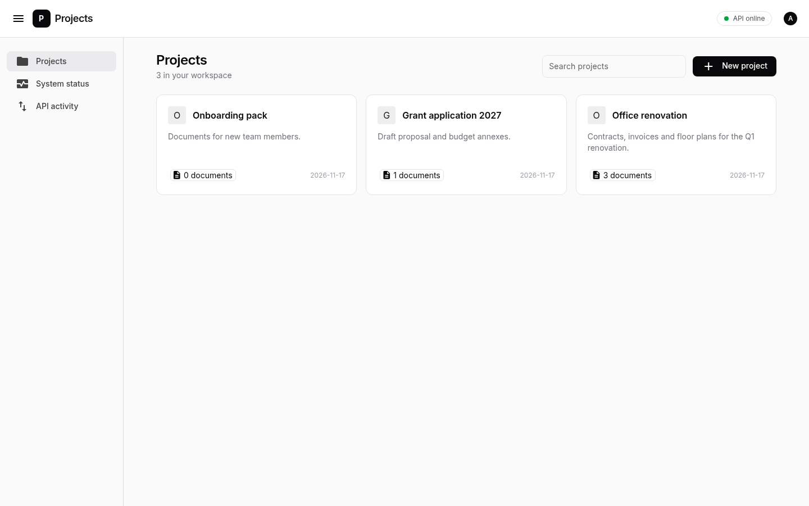
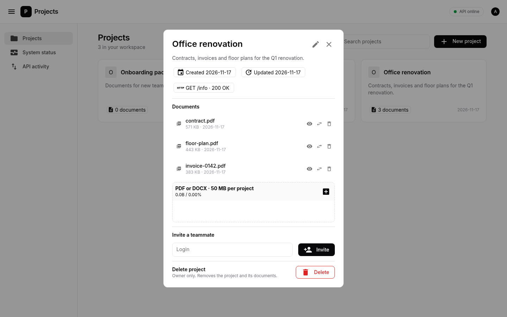

# Projects API

A REST API for managing projects and their documents. Users create projects, invite teammates and share PDF and DOCX files stored in S3, with a 50 MB limit per project.

## Features
- **Authentication** – registration and login with Argon2-hashed passwords and JWTs valid for 1 hour.
- **Projects** – create, list, view, edit and delete. Listing all projects returns their documents in a fixed number of queries.
- **Access control** – the owner can invite participants by login. Participants can edit the project and its files; only the owner can invite people or delete the project. Outsiders get `404`, so they cannot tell whether a project exists.
- **Documents** – upload one or many files at once, list, download, replace (same id, new content) and delete.
- **File validation** – the file type comes from its first bytes (`%PDF`, `PK`), not from the extension or the client's `Content-Type`. Anything else gets `415`.
- **Project size limit** – 50 MB per project, checked before anything reaches S3. Going over it gets `413`.
- **Private downloads** – the bucket is private. A download returns a redirect to a presigned URL that is valid for 5 minutes and issued only after the access check.
- **Invitations by email** – the owner can invite someone by email when they don't know the login. AWS SES sends a one-time join link valid for 7 days; only a SHA-256 hash of the token is stored, and joining burns it in a single atomic `DELETE ... RETURNING`.
- **Local mailbox** – locally, SES mail goes to Mailpit, so sent invitations can be opened at http://localhost:8025 without a real mail account.
- **Web UI** – a NiceGUI front end on top of the API.

## Tech Stack
- **Backend**: FastAPI, Pydantic v2, SQLAlchemy 2.0 (async), Alembic, PostgreSQL
- **AWS**: S3 and SES (boto3), MiniStack as a local AWS emulator, Mailpit as a local inbox
- **Infrastructure**: Docker Compose, Terraform (bucket, SES sender and least-privilege IAM policy as code)
- **Quality**: pytest + moto, ruff, mypy (strict), pre-commit, GitHub Actions
- **Frontend**: NiceGUI


## Screenshots

### Projects


### Project details, documents and invites


## Running Locally
```bash
cp .env.example .env
docker compose up --build
```

| Service | URL |
|---|---|
| API and Swagger docs | http://localhost:8000/docs |
| Web UI | http://localhost:8080 |
| Mailpit (sent emails) | http://localhost:8025 |
| MiniStack (S3, SES) | http://localhost:4566 |

Ports 8000, 8080, 8025, 4566 and 5432 must be free. The first start takes a few minutes: images are built and Terraform creates the bucket and the SES sender in the emulator. The `JWT_SECRET` in `.env.example` is for local use only.

## Development
```bash
poetry install
poetry run pre-commit install         # ruff and mypy run on every commit
docker compose up -d db               # integration tests use Postgres
poetry run pytest
```
